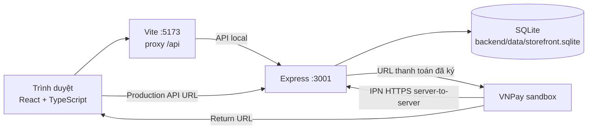

# Hướng dẫn triển khai và quản trị Dongo Storefront

Tài liệu được đối chiếu với package manifests, file khóa, source backend/frontend, Docker Compose và scripts hiện có. Có hai môi trường độc lập: SQLite cho chạy local/test và MySQL cho stack Docker Compose. Đây là hướng dẫn chạy trên máy phát triển Windows; dự án chưa được triển khai lên cloud hoặc cấu hình CI/CD.

## 1. Giới thiệu và kiến trúc

Dongo Storefront là ứng dụng thương mại điện tử phục vụ đồ án. Storefront React hiển thị catalog, giỏ hàng và checkout; backend Express cung cấp API, xác thực, phân quyền, tính lại giá/tạo đơn và tích hợp VNPay sandbox. Backend dùng SQLite ở chế độ local/test hoặc MySQL trong Compose; không tự chuyển dữ liệu giữa hai chế độ.

| Thành phần | Công nghệ | Vai trò |
|---|---|---|
| Giao diện | React 19, TypeScript, Vite 8 | Storefront và khu vực admin trong trình duyệt |
| API | Node.js, Express 5, Zod | REST API, validation, auth và nghiệp vụ |
| Dữ liệu | SQLite qua `node:sqlite`; MySQL qua `mysql2` | SQLite cho local/test; MySQL cho Docker Compose |
| Bảo mật phiên | bcryptjs, JWT cookie `HttpOnly` | Băm mật khẩu và phiên đăng nhập |
| Thanh toán | VNPay sandbox, HMAC-SHA512 | Tạo URL thanh toán, xác minh IPN/Return |
| Reverse proxy | Nginx | Phục vụ frontend, chuyển tiếp `/api`, security headers và JSON access log |
| Metrics/logs | Prometheus, Grafana, Loki, Grafana Alloy | Scrape backend/exporters, dashboard và tập trung log JSON |
| Kiểm thử | Node.js test runner, Oxlint, TypeScript | Test backend/frontend, lint và type-check |



Trong development Vite proxy `/api` đến backend. Return URL chỉ phục vụ trình duyệt; IPN hợp lệ mới xác nhận thanh toán. Callback thành công đến muộn từ attempt bị thay thế/đơn đã được thanh toán được lưu để đối soát, không tự hoàn tiền.

Sơ đồ trên mô tả chế độ local. Docker Compose chạy frontend và backend qua Nginx, backend kết nối MySQL trong network nội bộ; Prometheus/Grafana phục vụ metrics và Loki nhận log qua Grafana Alloy. MySQL dùng named volume độc lập với SQLite local; Compose không nhập hoặc thay đổi file SQLite sẵn có.

## 2. Yêu cầu môi trường và cấu hình

### Môi trường

- Windows 10/11 và PowerShell được dùng để viết/kiểm tra quy trình bàn giao; dự án không khai báo ma trận hệ điều hành chính thức.
- Node.js `>=22.5.0`, lấy từ `engines` ở package gốc và hai workspace. Bản dùng để chạy kiểm tra trong phiên này: Node.js 26.5.1.
- npm đi kèm Node.js; dự án khuyến nghị npm 9+ trong README. Lockfile dùng phiên bản 3.
- Không cần cài server SQLite riêng. Node.js cung cấp `node:sqlite`.
- Cổng mặc định: Vite `5173`, Express `3001`; Vite cấu hình proxy qua `frontend/vite.config.ts`.
- Chạy stack container cần Docker Desktop với Docker Compose v2. Các dịch vụ Compose dùng MySQL 8.4 và các named volumes riêng.

### Biến môi trường

Nguồn mẫu backend là `backend/.env.example`; Vite đọc `.env` frontend nếu cần URL API khác.

| Biến | Mục đích | Yêu cầu |
|---|---|---|
| `NODE_ENV` | Môi trường Node | Mẫu development; production yêu cầu secret phiên đủ mạnh |
| `PORT`, `HOST` | Cổng/địa chỉ lắng nghe API | Mặc định `3001`, `0.0.0.0` |
| `DATABASE_PATH` | Đường dẫn SQLite | Mặc định `data/storefront.sqlite`, tương đối với thư mục `backend` |
| `DB_DRIVER` | Chọn adapter database | `sqlite` mặc định; Compose đặt `mysql` |
| `DB_HOST`, `DB_PORT`, `DB_NAME`, `DB_USER`, `DB_PASSWORD` | Kết nối MySQL | Chỉ cần khi chạy với `DB_DRIVER=mysql` |
| `DB_CONNECTION_LIMIT` | Kích thước pool MySQL | Compose mặc định là 10 |
| `SESSION_SECRET` | Ký JWT phiên | Development có thể tạo tạm và cảnh báo; production bắt buộc ít nhất 32 byte |
| `TRUST_PROXY` | Tin proxy ngược | `0` mặc định; chỉ bật theo cấu hình proxy tin cậy |
| `COOKIE_SECURE`, `SESSION_COOKIE_SAME_SITE` | Cấu hình cookie | Local HTTP dùng `false`/`lax`; `SameSite=None` đòi HTTPS/secure |
| `FRONTEND_ORIGIN`, `CORS_ORIGINS` | Origin frontend được phép, Return URL | Local mặc định `http://localhost:5173` |
| `VNPAY_TMN_CODE`, `VNPAY_HASH_SECRET` | Merchant sandbox và khóa ký | Bỏ trống khi không thử VNPay; chỉ điền sandbox credentials riêng |
| `VNPAY_RETURN_URL`, `VNPAY_IPN_URL` | Endpoint callback | Khi thử sandbox cần HTTPS công khai và IPN được khai báo ở merchant |
| `VITE_API_BASE_URL` | Base URL API frontend | Để trống khi dùng Vite proxy `/api` |

Không ghi secret thật vào mã nguồn, tài liệu, terminal capture hoặc ZIP. Không chia sẻ file `.env`.

## 3. Cài đặt và khởi động từ đầu

1. Giải nén ZIP bàn giao vào thư mục người dùng có quyền ghi; không chạy trong `Program Files` hoặc thư mục đồng bộ hạn chế quyền.
2. Mở PowerShell và chuyển đến thư mục gốc đã giải nén:

   ```powershell
   Set-Location 'C:\duong-dan\Dongo-Storefront'
   ```

3. Kiểm tra runtime và cài đúng lockfile:

   ```powershell
   node --version
   npm --version
   npm ci
   ```

4. Tạo file môi trường backend từ mẫu nếu chưa có:

   ```powershell
   if (!(Test-Path backend/.env)) { Copy-Item backend/.env.example backend/.env }
   ```

   Tạo `SESSION_SECRET` ngẫu nhiên riêng tối thiểu 32 byte; lệnh PowerShell gợi ý:

   ```powershell
   [Convert]::ToBase64String([Security.Cryptography.RandomNumberGenerator]::GetBytes(48))
   ```

   Mở `backend/.env`, thay placeholder bằng giá trị cục bộ của bạn. Không cần điền cấu hình VNPay nếu chỉ trình diễn giao diện/đơn chờ thanh toán. File `.env.example` frontend có thể giữ `VITE_API_BASE_URL` trống để dùng proxy.

5. Khởi động backend và frontend bằng script workspace:

   ```powershell
   npm run dev
   ```

6. Mở `http://localhost:5173`. Kiểm tra API bằng `http://localhost:3001/api/health`.
7. SQLite mặc định được tạo tại `backend/data/storefront.sqlite`. Backend gọi `database.prepare('SELECT 1')` trong health endpoint; lần khởi động đầu cũng tạo schema/seed bằng `createDatabase`.
8. Dừng cả hai tiến trình bằng `Ctrl+C` trong terminal đang chạy `npm run dev`.

Có thể chạy frontend/backend ở terminal riêng bằng `npm run dev:frontend` và `npm run dev:backend`; hai script phải được chạy từ thư mục gốc.

### Chạy Docker Compose với MySQL và monitoring

1. Cài và khởi động Docker Desktop. Tại thư mục gốc dự án, tạo file môi trường cục bộ bằng script sinh secrets:

   ```powershell
   powershell -NoProfile -ExecutionPolicy Bypass -File scripts/New-ComposeEnv.ps1
   ```

   Script chỉ tạo file khi đường dẫn chưa tồn tại; nếu `.env` đã có, script dừng mà không ghi đè. Trên Windows, file được giới hạn ACL cho tài khoản hiện tại. Giá trị secrets được sinh bằng cryptographic RNG; password exporter là hexadecimal.
2. Không in/chia sẻ `.env`, không đưa file này vào Git. Script không cấu hình credential VNPay; để trống khi không thực hiện sandbox.
3. Kiểm tra cấu hình rồi build/khởi động:

   ```powershell
   docker compose config -q
   docker compose up -d --build
   docker compose ps
   ```

4. Đường dẫn mặc định:
   - Website và API qua Nginx: `http://localhost:8080` và `/api/health`.
   - phpMyAdmin: `http://localhost:8081`; dùng `MYSQL_USER`/`MYSQL_PASSWORD` trong `.env`.
   - Prometheus: `http://localhost:9090`.
   - Grafana: `http://localhost:3000`; đăng nhập `admin` và `GRAFANA_ADMIN_PASSWORD`.
   - Có thể đổi cổng host bằng `HTTP_PORT`, `PHPMYADMIN_PORT`, `PROMETHEUS_PORT`, `GRAFANA_PORT`. Các cổng được bind vào `127.0.0.1`.
5. Dashboard `Dongo Operations` được provision sẵn. Prometheus truy vấn backend `/metrics`, MySQL exporter, Nginx exporter, cAdvisor và Alloy. Trên Docker Desktop, cAdvisor có thể chỉ thấy VM Linux và không liệt kê container riêng; dashboard có fallback host-level và sẽ hiện tên `host`. Grafana Explore có thể chạy `{job="backend"} | json` và `{job="nginx"} | json | status="200"`.
6. Để cấp admin trong DB MySQL Compose, đăng ký tài khoản trước rồi chạy với email đã đăng ký:

   ```powershell
   docker compose exec -T backend node backend/server/promote-admin.js admin@example.com
   ```

   Đăng xuất và đăng nhập lại để refresh role. Không có tài khoản admin mặc định.
7. Dừng stack mà vẫn giữ database/metrics/logs:

   ```powershell
   docker compose down
   ```

   **Không dùng `docker compose down -v`** nếu muốn bảo toàn named volumes. Không chạy lệnh khởi tạo/khôi phục SQLite trên MySQL volume; hai DB độc lập, không có migration dữ liệu tự động. Cấu hình Compose là demo HTTP trên loopback, không phải cấu hình production.

Grafana Alloy được pin ở `v1.20.1`. Cấu hình Promtail hiện hữu đã được chuyển bằng Alloy convert, chạy canary song song trên log volumes chỉ đọc, và xác minh log backend/Nginx cùng query LogQL tới Loki; positions legacy được nhập vào storage riêng của Alloy. Tài liệu Promtail EOL: [Grafana Loki documentation](https://grafana.com/docs/loki/latest/send-data/promtail/).

**Rollback log agent:** không xóa `promtail_positions` hoặc `alloy_data`. Nếu Alloy lỗi, trước hết chạy `docker compose stop alloy` (không xóa volume); sau đó dùng `docker/promtail/promtail.yml` đã giữ nguyên, khôi phục service `promtail` và target Prometheus `promtail:9080` thay cho `alloy:9080`, rồi áp dụng `docker compose up -d --no-deps promtail prometheus`. Giữ nguyên volume trạng thái Alloy trong khi xác minh; Promtail có thể gửi lại một số log kể từ checkpoint cũ (duplicate), nhưng không xóa log hoặc checkpoint. Không chạy hai agent cùng lúc trỏ vào một Loki khi không chủ ý chấp nhận log trùng.

## 4. Kiểm tra sau triển khai

Không ghi trước kết quả. Khi thực hiện trên máy nhận bàn giao, ghi kết quả vào cột cuối.

| Hạng mục | Cách kiểm tra | Kết quả mong đợi | Kết quả thực tế |
|---|---|---|---|
| Frontend | Mở `http://localhost:5173` | Trang Dongo tải không có trang lỗi kết nối | Chưa kiểm tra trên máy nhận |
| Backend | Xem terminal sau `npm run dev` | API lắng nghe cổng cấu hình; không có lỗi khởi động | Chưa kiểm tra trên máy nhận |
| Health | `Invoke-RestMethod http://localhost:3001/api/health` | JSON `{"status":"ok"}` | Chưa kiểm tra trên máy nhận |
| Database | Chạy script Verify theo mục 5 với file SQLite | `PRAGMA quick_check` trả `ok` | Chưa kiểm tra trên máy nhận |
| Catalog | Gọi `Invoke-RestMethod http://localhost:3001/api/products` | Trả danh sách sản phẩm đang active từ DB cấu hình | Chưa kiểm tra trên máy nhận |
| Authentication | Đăng ký/login rồi refresh/logout | Session khôi phục và bị xóa sau logout | Chưa kiểm tra trên máy nhận |
| Phân quyền | Customer truy cập `/admin`/API admin; thử lại bằng admin | Backend từ chối customer; admin đọc được dữ liệu quản trị | Chưa kiểm tra trên máy nhận |
| Giỏ/đơn | Thêm giỏ và checkout; đơn cần login | Backend kiểm tra quantity/địa chỉ và tính giá theo catalog | Chưa kiểm tra trên máy nhận |
| Quản trị | Đăng nhập admin và kiểm tra tab order/user/product | Dashboard tải dữ liệu backend; quyền được xác nhận server-side | Chưa kiểm tra trên máy nhận |
| VNPay sandbox | Tạo giao dịch sandbox, quan sát IPN HTTPS và order | Chỉ IPN đã xác minh mới chuyển paid | Chưa xác minh E2E; cần merchant sandbox |

Health endpoint xác thực khả năng truy vấn DB tối thiểu, nhưng không thay cho kiểm tra nghiệp vụ, sao lưu hay quyền.

## 5. Sao lưu và khôi phục SQLite

### Hiện trạng và phương pháp

- Backend gọi `createDatabase(process.env.DATABASE_PATH || 'data/storefront.sqlite')` từ workspace `backend`; đường dẫn mặc định đầy đủ là `backend/data/storefront.sqlite`.
- Schema bật `PRAGMA foreign_keys = ON` và `busy_timeout = 5000`; code hiện không đặt `journal_mode=WAL`. Database được kiểm tra trong phiên này trả `journal_mode=delete` và `PRAGMA quick_check=ok`.
- Khi tắt backend, `server/index.js` đóng HTTP server trước rồi gọi `database.close()`.
- Script dùng `DatabaseSync.serialize()` của `node:sqlite` để lấy snapshot nhất quán do chính SQLite cung cấp, sau đó xác minh bằng mở read-only và `PRAGMA quick_check`. Cách này nhìn thấy trạng thái đã commit kể cả nếu cấu hình SQLite sử dụng WAL; không tự copy riêng file DB đang mở.
- Script dùng API có từ Node `22.5.0`; không cài SQLite CLI hay package bổ sung.

### Tạo backup

Script đọc `DATABASE_PATH` từ process environment, nếu chưa đặt thì từ `backend/.env`, nếu cũng thiếu thì dùng mặc định của backend. Giá trị tương đối được resolve từ thư mục `backend`.

```powershell
powershell -NoProfile -ExecutionPolicy Bypass -File scripts/Manage-SqliteDatabase.ps1 -Action Backup
```

File mới được tạo, không ghi đè file có sẵn, trong thư mục `backups` cạnh database, tên có timestamp. Không xóa bản backup cũ. Có thể chọn đích mới:

```powershell
powershell -NoProfile -ExecutionPolicy Bypass -File scripts/Manage-SqliteDatabase.ps1 -Action Backup -BackupPath 'E:\DongoBackups\storefront-before-demo.sqlite'
```

Lệnh in đường dẫn database/backup, không in giá trị biến bí mật. Backup chứa dữ liệu tài khoản/đơn hàng; bảo vệ và chuyển giao như dữ liệu nhạy cảm.

### Xác minh backup

```powershell
powershell -NoProfile -ExecutionPolicy Bypass -File scripts/Manage-SqliteDatabase.ps1 -Action Verify -BackupPath 'E:\DongoBackups\storefront-before-demo.sqlite'
```

Pass nghĩa là file có schema ứng dụng và `PRAGMA quick_check` trả `ok`; không chứng minh backup là đúng thời điểm/đúng môi trường. Ghi lại ngày tạo, nguồn database và người thực hiện ở hồ sơ quản trị riêng.

### Khôi phục an toàn

**Khôi phục thay dữ liệu hiện hành.** Kiểm tra đúng file backup, môi trường và ngày trước khi làm.

1. Dừng backend bằng `Ctrl+C`. Script từ chối restore nếu port API đang lắng nghe. Nếu đổi `PORT`, script đọc cùng giá trị process hoặc `.env`.
2. Xác minh backup trước:

   ```powershell
   powershell -NoProfile -ExecutionPolicy Bypass -File scripts/Manage-SqliteDatabase.ps1 -Action Verify -BackupPath 'E:\DongoBackups\storefront-before-demo.sqlite'
   ```

3. Chạy restore với xác nhận bắt buộc:

   ```powershell
   powershell -NoProfile -ExecutionPolicy Bypass -File scripts/Manage-SqliteDatabase.ps1 -Action Restore -BackupPath 'E:\DongoBackups\storefront-before-demo.sqlite' -ConfirmRestore RESTORE
   ```

4. Script trước tiên tạo safety backup hiện tại (nếu DB tồn tại), tạo bản stage từ backup, kiểm tra stage, giữ DB cũ và các sidecar `-wal`, `-shm`, `-journal` với hậu tố `.pre-restore-<timestamp>`, rồi thay file DB và kiểm tra lại. Không xóa các bản backup/snapshot cũ.
5. Nếu thao tác thay thế lỗi, script cố phục hồi các file gốc đã chuyển. Không xóa thủ công file `.pre-restore-*` khi chưa xác minh.
6. Khởi động backend lại, kiểm tra `/api/health`, đăng nhập và xác minh catalog/đơn mong đợi. Nếu khôi phục sai thời điểm, dừng và chọn backup đúng sau khi giữ lại bản hiện hành.

Không chạy restore khi backend còn hoạt động. Script port-check là lớp bảo vệ bổ sung, không phát hiện mọi cách chạy backend ở cổng tùy biến khác, service ngoài máy hoặc tiến trình đã đổi cấu hình. Việc dừng đúng backend vẫn là trách nhiệm người vận hành.

### Kiểm thử trên dữ liệu thử nghiệm

Không thử restore vào database cá nhân. Quy trình kiểm tra dùng file SQLite tạm riêng: tạo fixture, Backup, Verify, thay đổi fixture, Restore vào chính DB thử nghiệm, rồi xác nhận giá trị gốc quay lại và safety backup được tạo. Kết quả thực tế của lần chạy trong phiên này được ghi ở mục 9; xóa file tạm sau khi kiểm tra.

## 6. Cấu hình, quyền và an toàn

- `.gitignore` loại trừ `.env` (trừ `.env.example`), database SQLite/WAL/SHM, `data/`, backup, log, credentials, private key, `node_modules`, `dist` và ZIP.
- Root `.env` của Compose chứa credentials MySQL, session và Grafana; giữ file cục bộ, không đưa vào Git/ZIP hoặc ảnh chụp. Các cổng giao diện được bind vào loopback, nhưng demo vẫn dùng HTTP và cookie không Secure; không mở ra Internet hoặc coi đây là hardening production.
- Script `scripts/New-ComposeEnv.ps1` sinh secrets ngẫu nhiên và từ chối ghi đè file tồn tại. Không chạy script với `-OutputPath` trỏ vào file cấu hình người dùng; chỉ dùng khi cần tạo file mới.
- Script đóng gói dùng allow-list; khi cập nhật file bàn giao cần kiểm tra script và danh sách ZIP. Không dùng lệnh zip toàn thư mục workspace.
- Đăng ký luôn tạo customer. Cấp admin có kiểm soát: đăng ký email trước rồi chạy từ root, với database đúng môi trường:

  ```powershell
  npm run admin:promote --workspace=backend -- admin@example.com
  ```

  Lệnh dùng `backend/.env`/`DATABASE_PATH` và yêu cầu đăng nhập DB local; kiểm tra email cẩn thận để không cấp quyền nhầm. Backend bảo vệ endpoint admin, không chỉ UI.
- Không mở rộng CORS hoặc TRUST_PROXY cho tiện demo nếu không có kiến trúc proxy phù hợp.
- Khi production, backend từ chối `SESSION_SECRET` ngắn; cookie cần HTTPS theo cấu hình. Hướng dẫn này không cấu hình production hoặc merchant production.

## 7. Log và xử lý sự cố

Ở local, backend ghi log ra stdout/stderr; frontend dùng thông báo UI/console trình duyệt. Trong Compose, backend ghi JSON vào named volume `backend_logs`, Nginx ghi access log JSON vào `nginx_logs`; Grafana Alloy mount hai volume read-only và gửi log tới Loki. Prometheus lấy metrics từ backend/exporters/Alloy; dashboard Grafana `Dongo Operations` hiển thị health, HTTP, database, cAdvisor CPU/memory và logs. Trên Docker Desktop, cAdvisor hiện có thể chỉ cung cấp số liệu VM Linux, không có series theo từng container; dashboard dùng host-level fallback và ghi tên `host`. Không ghi/chia sẻ mật khẩu, cookie JWT, secret, nội dung thanh toán hoặc export dữ liệu khách hàng. Cấu hình Promtail cũ vẫn được giữ để rollback; Promtail đã EOL.

| Sự cố / dấu hiệu | Nguyên nhân cần kiểm tra | Khắc phục an toàn | Xác minh |
|---|---|---|---|
| `npm ci` lỗi | Node dưới `22.5.0`, mạng/proxy, quyền file, process giữ native binding | Kiểm tra `node --version`, `npm --version`; đóng tiến trình Dongo cũ bằng Ctrl+C; kiểm tra quyền/mạng; chạy lại `npm ci` tại root. Không xóa database | `npm ls --depth=0`; chạy test/build |
| Cổng frontend/backend đã chiếm | Server cũ hoặc ứng dụng khác đang nghe `5173`/`3001` | `Get-NetTCPConnection -State Listen -LocalPort 5173,3001`; xác định PID bằng `Get-Process -Id <PID>`; chỉ dừng PID đã xác nhận thuộc app của bạn. Không giết process theo tên hàng loạt | `npm run dev`, kiểm tra hai URL |
| Backend không khởi động | `.env` lỗi, secret production ngắn, port chiếm, đường dẫn DB/quyền ghi | Xem lỗi terminal; kiểm tra tên biến, không in giá trị secret; xác minh thư mục DB ghi được; tránh xóa DB | Backend log báo lắng nghe và `/api/health` trả `ok` |
| Frontend không gọi API | Backend tắt, proxy target/port sai, API base URL sai, CORS | Mở Network tab; kiểm tra Vite proxy và backend port; để `VITE_API_BASE_URL` trống cho local proxy; chỉ thêm origin cần thiết vào CORS | `curl.exe http://localhost:3001/api/health`; tải catalog |
| DB không mở/ghi | Sai `DATABASE_PATH`, file/parent read-only, database bị lock/corrupt | Đọc đường dẫn từ cấu hình mà không in secrets; đảm bảo quyền thư mục; đóng app khác; kiểm tra bằng `Action Verify`/`quick_check`; khôi phục chỉ sau safety backup | API health, đăng nhập và ghi thao tác test trên DB demo |
| Docker service unhealthy | Docker Engine dừng, port host đã dùng, secret Compose còn trống/sai hoặc dependency chưa healthy | `docker compose ps` và `docker compose logs --tail 100 <service>`; kiểm tra tên biến trong `.env` nhưng không in giá trị. Không xóa volumes để xử lý khởi động | Tất cả service `healthy` hoặc `running`; Nginx `/api/health` trả `ok` |
| MySQL target down | Exporter chưa khởi động, monitor user chưa tồn tại trong MySQL volume cũ, mật khẩu monitor không hợp lệ | Xem `docker compose logs --tail 100 mysql-exporter mysql`; user init chỉ tự chạy khi volume được khởi tạo mới. Nếu volume đã có, cấp quyền monitor có kiểm soát theo script init; không xóa volume | Prometheus `/api/v1/targets` cho job `mysql` là `up`; `mysql_up` là `1` |
| cAdvisor chỉ hiện host, không hiện container | Docker Desktop không expose container cgroups qua mount hiện tại | Xem series `container_cpu_usage_seconds_total` trong Prometheus; dashboard tự dùng VM host fallback nếu không có series theo `name`. Không mount Docker socket một cách tùy tiện vì nó cấp quyền mạnh lên Docker Engine | Dashboard có series `host`; ghi rõ giới hạn nếu cần metrics per-container |
| Không thấy log ở Grafana | Promtail chưa đọc đúng volume/path, Loki không reachable, chưa có request mới | Kiểm tra log Promtail/Loki, đường dẫn log và target; tạo request không chứa dữ liệu nhạy cảm; thử LogQL `{job="backend"} | json` hoặc `{job="nginx"} | json` | Grafana Explore trả stream backend và nginx có thời gian gần đây |
| Login hoặc phân quyền lỗi | Phiên cũ/cookie, sai backend DB, tài khoản customer chưa promote | Xem trạng thái `/api/auth/me`; đăng nhập lại; xác nhận terminal/script trỏ đúng `DATABASE_PATH`; chỉ promote email đã xác minh | Admin API hoạt động với admin và bị 403 với customer |
| Ảnh sản phẩm không tải | File local thiếu/path sai hoặc URL từ xa lỗi | Xác nhận `image` trong API, file public có tồn tại và DevTools Network; component ảnh có fallback một lần. Không thay URL DB bằng placeholder chung | Ảnh local HTTP 200 và `naturalWidth > 0` |
| VNPay không trả kết quả/IPN không đến | Chưa cấu hình sandbox, URL callback không HTTPS/public, merchant IPN chưa khai báo hoặc chữ ký/amount sai | Chỉ dùng sandbox; kiểm tra các biến bằng cách xác nhận có/không, không in giá trị; dùng HTTPS tunnel được phép; xem log IPN đã lọc nhạy cảm. Không tự đánh dấu paid | Chỉ IPN ký hợp lệ cập nhật; Return URL đơn thuần vẫn pending |
| Test/lint/build lỗi | Lỗi assertion, type/source, dependency hoặc môi trường | Chạy script thực tế: `npm test`, `npm run lint`, `npm run lint --workspace=backend`, `npm run build`; đọc lỗi đầu tiên và sửa nguyên nhân. Không xóa test/che lỗi | Lệnh tương ứng thoát mã 0; ghi lỗi còn lại |

## 8. Lệnh kiểm thử trước bàn giao

Scripts hiện khai báo:

| Mục đích | Lệnh |
|---|---|
| Backend + frontend tests | `npm test` |
| Frontend lint | `npm run lint` |
| Backend syntax check | `npm run lint --workspace=backend` |
| TypeScript check + frontend production build | `npm run build` (`tsc -b && vite build`) |
| Backend tests riêng | `npm test --workspace=backend` |
| Frontend tests riêng | `npm test --workspace=frontend` |
| Run backend + frontend | `npm run dev` |

Không có script type-check độc lập; TypeScript được kiểm tra bởi `npm run build`.

## 9. Kết quả xác minh trong phiên lập tài liệu

| Hạng mục | Lệnh/thao tác | Kết quả thực tế |
|---|---|---|
| Runtime | `node --version`; `npm --version` | Node `v26.5.1`; npm `11.17.0` |
| Lockfile | Đọc đầu `package-lock.json` | Lockfile version 3; workspaces frontend/backend |
| Database nguồn | `PRAGMA journal_mode`; `PRAGMA quick_check` read-only | `delete`; `ok`; không in dữ liệu người dùng |
| Dependency tree | `npm ls --workspaces --depth=0` | Pass; hai workspace và dependency cài đặt được liệt kê, không báo missing/invalid |
| Tests | `npm test` | Pass: backend 7/7, frontend 4/4; tổng 11/11, 0 fail |
| Frontend lint | `npm run lint` | Pass — Oxlint |
| Backend lint | `npm run lint --workspace=backend` | Pass — syntax check các module backend |
| TypeScript/build | `npm run build` | Pass — `tsc -b`, Vite 8.3.2 build, 1.893 modules |
| Health/UI/catalog | HTTP GET `/`, GET `/api/health`, GET `/api/products` | Frontend HTTP 200, health `ok`, 8 sản phẩm active |
| Docker Compose / MySQL | Compose test project riêng; `/api/health`, catalog, đăng ký/tạo/đọc đơn, phpMyAdmin | Pass; MySQL backend hoạt động, 8 sản phẩm seed và phpMyAdmin HTTP 200 |
| Prometheus | `/api/v1/targets`, `dongo_database_up`, `mysql_global_status_threads_connected` | Pass; backend, containers, Loki, MySQL, Nginx, Prometheus, Promtail đều `up`; DB health `1`; MySQL threads connected `2` tại thời điểm truy vấn |
| cAdvisor panels | PromQL CPU/memory dashboard với fallback `id="/"` | Pass có giới hạn; có series host-level VM Linux, chưa có breakdown từng container trên Docker Desktop |
| Log pipeline | Loki query `{job="backend"} | json` và `{job="nginx"} | json | status="200"` qua Grafana | Pass; cả hai query trả 5 log entries trong cửa sổ kiểm tra |
| Dashboard / exporters | Grafana health và provisioned dashboard; exporter MySQL | Pass; Grafana HTTP 200, dashboard `dongo-operations` tồn tại, MySQL target `up` |
| `npm ci` | Không chạy trong lượt này | Tránh dừng server đang phục vụ và thay `node_modules`; clean install đã Pass ở lượt kiểm tra Windows trước theo lịch sử dự án |
| Backup/restore fixture | Tạo SQLite thử nghiệm WAL, Backup, Verify, mutate rồi Restore | Pass; fixture trở về `before-restore`, `quick_check=ok`, safety backup được giữ. Database nguồn không bị restore/ghi đè |
| WAL đang mở | Backup fixture khi có commit còn trong file `-wal` | Pass; snapshot giữ hàng đã commit và `quick_check=ok` |
| Chặn restore khi backend hoạt động | Restore thử với API port đang lắng nghe | Pass; script từ chối trước khi đụng target |
| Script mới | `node --check scripts/sqlite-maintenance.mjs`; parse hai PowerShell scripts | Pass |
| SQLite helper sau khi hoàn thiện | Backup, Verify, restore-stage trên fixture; kiểm tra đích đã tồn tại | Pass; dữ liệu staging khớp snapshot, đích có sẵn được giữ nguyên |
| VNPay E2E | Không gọi merchant | Chưa xác minh; cần merchant sandbox/IPN HTTPS |

Test fixture được tạo trong thư mục tạm riêng và dọn sau khi xác minh. Restore đã giữ safety backup trước trạng thái thử nghiệm. Database gốc không được restore; metadata file nguồn được so sánh trước/sau, không thay đổi.

Backend test có thông báo lỗi database/VNPay được chủ ý mô phỏng để xác minh rollback và trả lỗi; cả hai test tương ứng vẫn Pass. Không phải lỗi test hoặc thanh toán thật.

## 10. Tạo ZIP bàn giao

Script allow-list là `scripts/New-HandoffZip.ps1`. Script đóng gói cả `docs/` và loại trừ `.env` thật, SQLite/backup, `node_modules`, build output, log, key/certificate và ZIP bên trong. Mặc định đầu ra thống nhất là `Dongo-Storefront-handoff-final.zip` ở thư mục cha workspace. Archive tạm được kiểm tra nội dung, cấu hình mẫu và đủ 8 ảnh sản phẩm trước; nếu đã có ZIP đích, chỉ thay thế sau khi kiểm tra đạt và đối chiếu SHA-256.

Tại root, tạo/gia hạn gói:

```powershell
powershell -NoProfile -ExecutionPolicy Bypass -File scripts/New-HandoffZip.ps1
```

Script cũng nhận `-OutputPath` nếu cần lưu ở nơi khác. Kiểm tra số lượng/danh sách file và SHA-256 được in ra; xác nhận có README, docs hướng dẫn, manifests/lockfile, `.env.example`, tests, scripts và 8 ảnh sản phẩm; không có `.env` thật, thư mục `data`, `backups`, SQLite, log hoặc `node_modules`.

Bản bàn giao chuẩn là `Dongo-Storefront-handoff-final.zip` ở thư mục cha workspace. Sau khi tạo, audit độc lập xác nhận số lượng file, đủ 8 ảnh sản phẩm cùng tài liệu/cấu hình mẫu/script cần thiết, không có file nhạy cảm, database, dependency đã cài hoặc build output.

## 11. Giới hạn và trách nhiệm vận hành

- Chưa triển khai cloud, chưa có CI/CD và không hỗ trợ VNPay production trong đồ án.
- Không có quản lý tồn kho, email xác minh/giao dịch, newsletter delivery, hãng vận chuyển hoặc refund automation.
- Backup có thông tin tài khoản/đơn hàng: phân quyền nơi lưu, mã hóa ổ đĩa theo chính sách trường học, và chỉ chia sẻ cho người được phép.
- Khôi phục backup cũ có thể làm mất các đơn/tài khoản phát sinh sau thời điểm backup. Luôn giữ safety backup hiện trạng và xác minh ngày/nguồn trước khi đổi DB.
