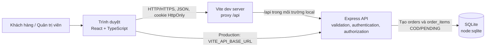
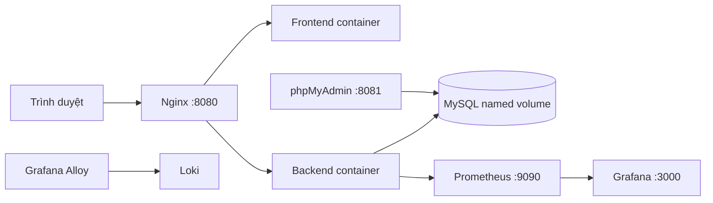

# 1. Tổng quan và kiến trúc

## Mục tiêu

Dongo Storefront là website bán lẻ trực tuyến phục vụ đồ án, minh họa danh mục sản phẩm, tài khoản khách hàng, giỏ hàng, tạo đơn có kiểm tra phía máy chủ, thanh toán khi nhận hàng (COD) và khu vực quản trị. Backend hỗ trợ SQLite cho local/test và MySQL cho stack Docker Compose; dữ liệu của hai chế độ tách biệt.

## Công nghệ

| Lớp | Công nghệ |
|---|---|
| Giao diện | React 19, TypeScript, Vite 8, Oxlint |
| API | Node.js `>=22.5.0`, Express 5 |
| Cơ sở dữ liệu | SQLite qua `node:sqlite` (local/test); MySQL qua `mysql2` (Compose) |
| Xác thực | bcryptjs, JWT trong cookie `HttpOnly` |
| Kiểm tra dữ liệu | Zod |
| Thanh toán | Thanh toán khi nhận hàng (COD) |
| Kiểm thử | Node.js test runner (`node --test`) |
| Vận hành Compose | Docker Compose, Nginx, phpMyAdmin |
| Metrics/logs | Prometheus, Grafana, Loki, Grafana Alloy |

## Sơ đồ thành phần và luồng dữ liệu

Trong môi trường phát triển Vite proxy `/api` tới backend cổng `3001`. Khi triển khai, frontend và API có thể được host riêng; `VITE_API_BASE_URL`, CORS và cookie HTTPS cần cấu hình theo môi trường.

Checkout gọi trực tiếp `POST /api/orders`. Backend xác thực dữ liệu, tính lại giá từ database rồi tạo đơn với `payment_method = 'COD'`, `status = 'PENDING'` và các dòng `order_items`; không có URL thanh toán hoặc callback bên thứ ba.

### Chế độ Docker Compose

Các cổng host được bind vào loopback. Backend có `/metrics`; Prometheus scrape backend, MySQL exporter, Nginx exporter, cAdvisor và Alloy; Alloy đọc JSON log backend/Nginx từ named volumes read-only và gửi Loki. SQLite local không bị mount/import vào MySQL. Stack là demo HTTP, không phải cấu hình production. Alloy v1.20.1 thay Promtail EOL; canary đã xác minh hai stream và import positions cũ. Cấu hình/volume Promtail vẫn được giữ để rollback.

## Module chính

- `frontend/src/App.tsx`: storefront, tìm kiếm/lọc/sắp xếp, trạng thái tài khoản, giỏ hàng, yêu thích và hộp thoại mua hàng.
- `frontend/src/Admin.tsx`: dashboard, quản trị sản phẩm, tài khoản và đơn hàng.
- `frontend/src/api.ts`: kiểu dữ liệu và hàm gửi request API.
- `frontend/src/ProductImage.tsx`, `frontend/src/product-image.ts`: resolve URL và hiển thị ảnh thống nhất.
- `backend/server/index.js`: nạp môi trường, chọn adapter SQLite/MySQL và lắng nghe HTTP.
- `backend/server/app.js`: endpoint, xác thực/phân quyền, validation và tạo đơn COD.
- `backend/server/db.js`, `backend/server/db-mysql.js`: adapter SQLite/MySQL, schema, seed và migration cộng thêm.

## Nguyên tắc nghiệp vụ

1. API catalog đọc sản phẩm đang hoạt động từ database được cấu hình.
2. Backend tính lại giá từ catalog, kiểm tra số lượng và dữ liệu giao hàng trong transaction; tạo đơn cần `Idempotency-Key`.
3. Đăng ký mới mặc định là `customer`; endpoint quản trị kiểm tra vai trò ở backend.
4. Đơn COD chờ thu tiền khi giao; admin có thể cập nhật tiến độ giao hàng theo từng bước.
5. SQLite local mặc định ở `backend/data/storefront.sqlite`; MySQL Compose dùng named volume riêng. Không đưa database cá nhân, backup hoặc `.env` thật vào gói nộp.

## Giới hạn đã biết

Chưa có email xác minh/giao dịch, quản lý tồn kho, tích hợp hãng vận chuyển hoặc gửi newsletter. Admin cập nhật fulfillment thủ công; không có tích hợp thanh toán trực tuyến.
