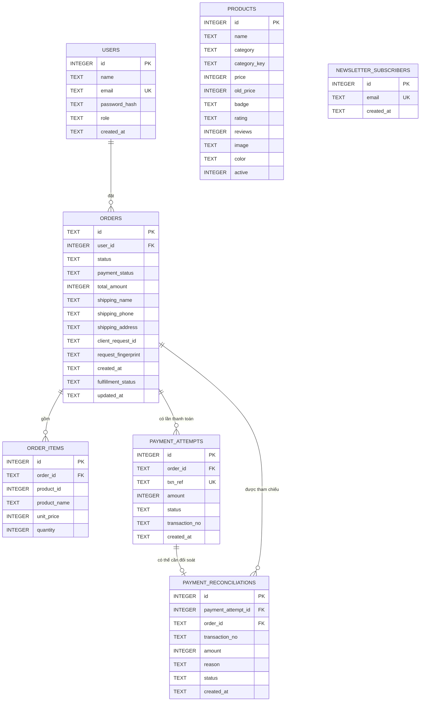

# 2. Sơ đồ cơ sở dữ liệu (ERD)

ERD dựa trên schema, index và migration trong `backend/server/db.js`. Không có bảng tồn kho. `order_items.product_id` không khai báo khóa ngoại; tên và giá được lưu snapshot tại lúc tạo đơn.

## Ràng buộc và ý nghĩa

- `users.email` và `newsletter_subscribers.email` duy nhất, không phân biệt hoa thường.
- `users.role`: `customer` hoặc `admin`.
- `orders.status`: COD order mới là `PENDING`; các giá trị cũ được giữ để tương thích dữ liệu lịch sử. `payment_method` của đơn mới là `COD`, `payment_status` được đặt `PAID` khi tạo đơn thành công.
- `orders.fulfillment_status`: `new`, `processing`, `shipped`, `delivered`. Admin có thể cập nhật đơn COD theo từng bước.
- `client_request_id` và `request_fingerprint` hỗ trợ idempotency; unique index áp dụng lên `(user_id, client_request_id)`.
- `order_items.order_id` tham chiếu `orders.id` với `ON DELETE CASCADE`; `product_id` không có FK. `product_name` và `unit_price` lưu snapshot lịch sử.
- `payment_attempts` và `payment_reconciliations` là cấu trúc lịch sử được giữ lại; luồng COD hiện tại không ghi giao dịch hoặc callback vào các bảng này.
- `products.price > 0`; `old_price` nếu có phải lớn hơn `price`; `reviews >= 0`; `active` là `0/1`.
- Bật foreign keys bằng `PRAGMA foreign_keys = ON`; có index cho đơn theo user/thời gian, attempt theo đơn và hàng đợi đối soát.

Migration theo hướng cộng thêm: bảng/index dùng `IF NOT EXISTS`; cột legacy được thêm có điều kiện. Migration ảnh chỉ đổi các giá trị seed legacy đã nhận diện và không thay URL ảnh tùy chỉnh.
