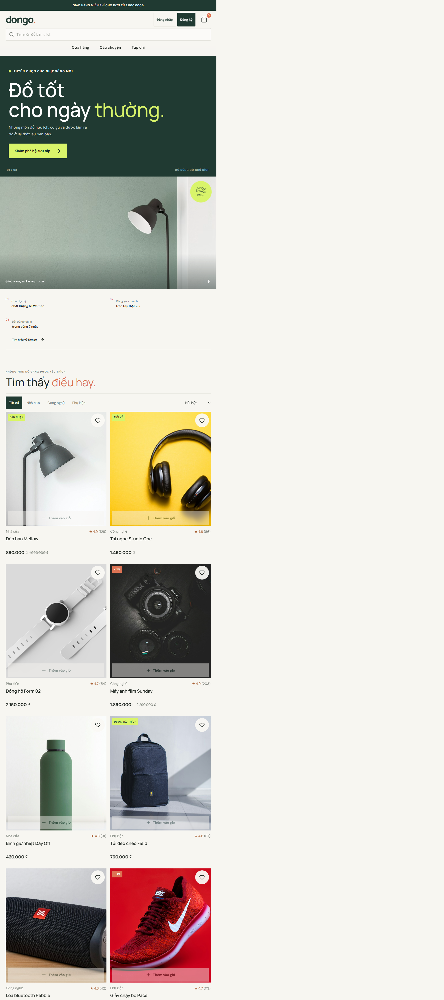
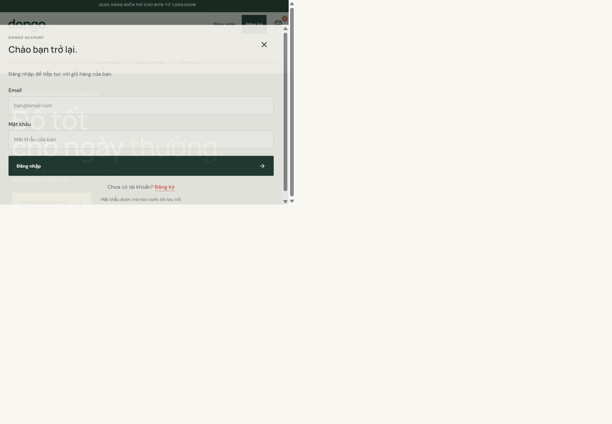
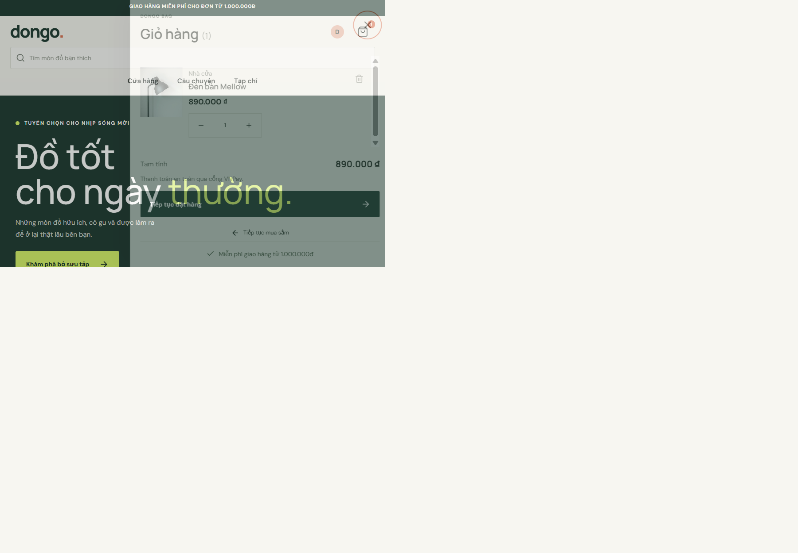
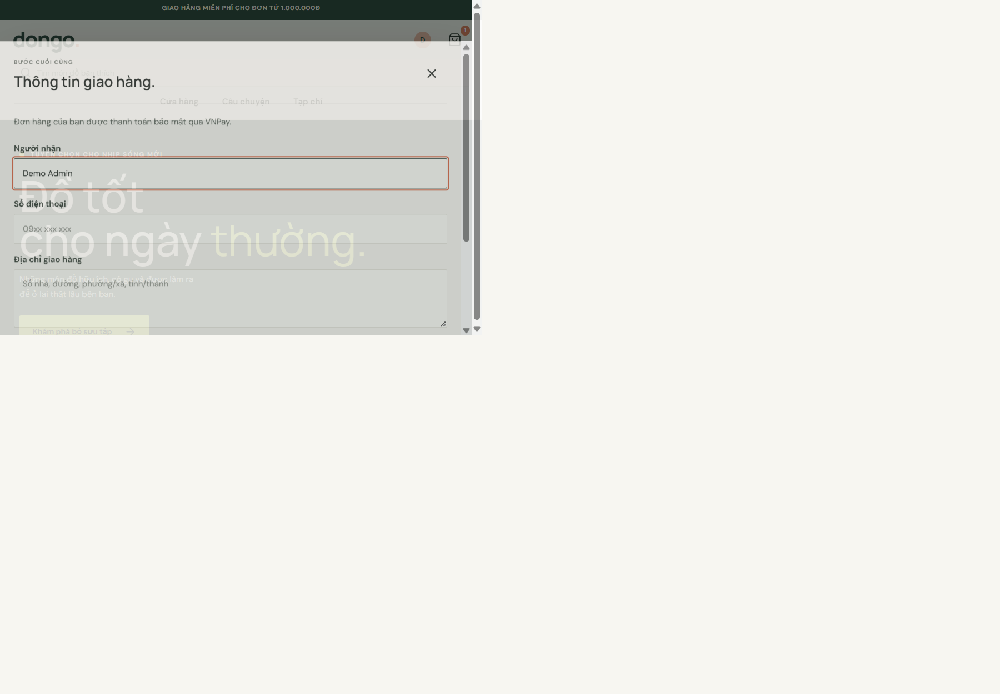
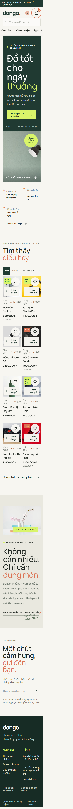
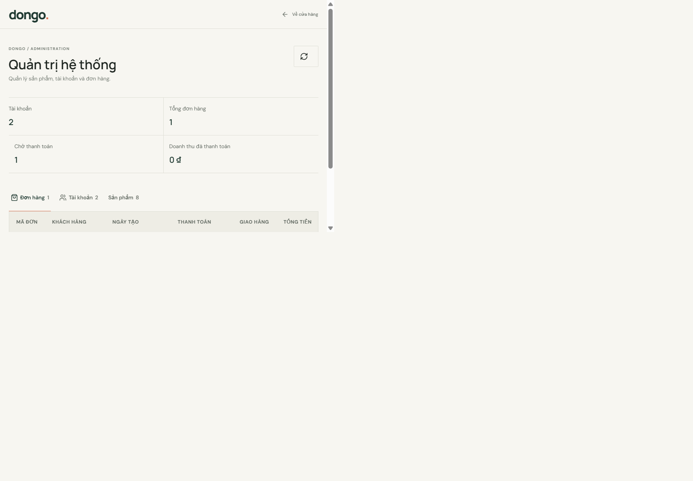
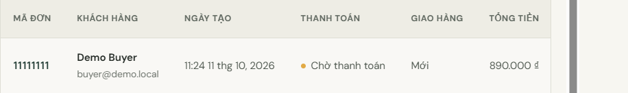
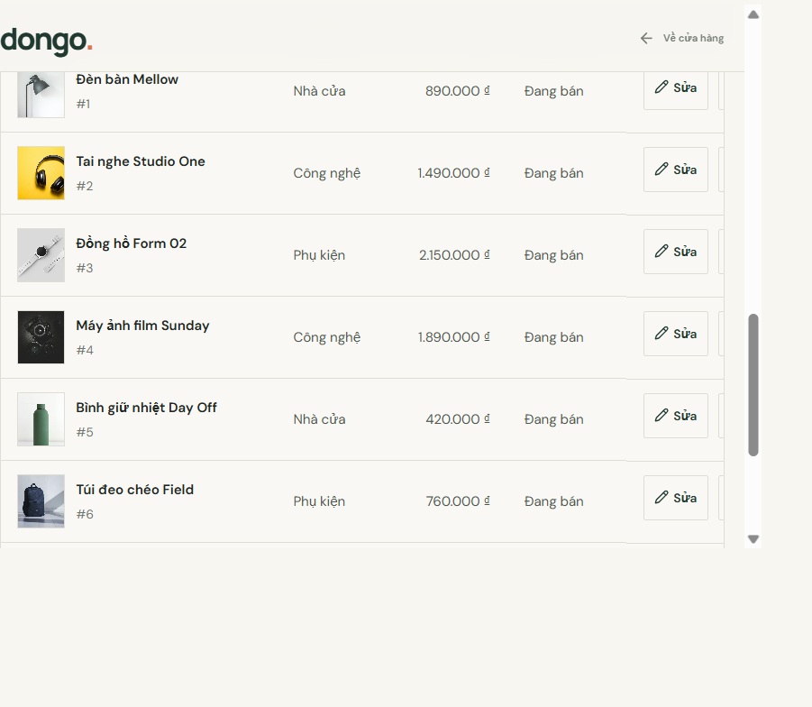
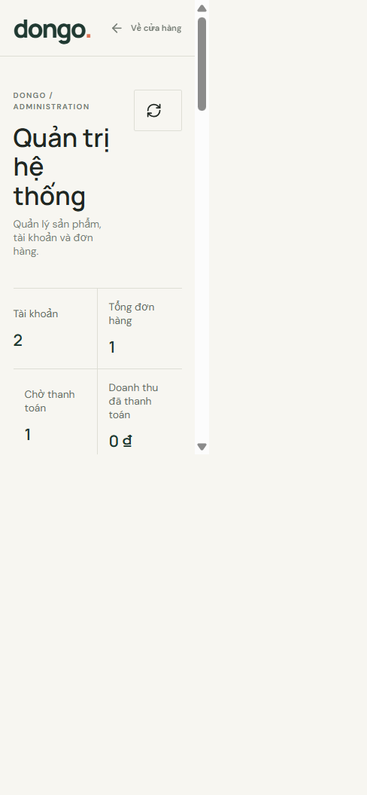

# 5. Kiểm thử giao diện

Ảnh là ảnh chụp trực tiếp từ ứng dụng đang chạy, không phải hình dựng. Admin/checkout dùng API cục bộ cùng SQLite `:memory:` và dữ liệu demo; không dùng dữ liệu cá nhân hay giao dịch thật.

## Ảnh chụp

### Storefront desktop

### Đăng nhập

### Giỏ hàng

### Checkout trước khi gửi

Không submit form checkout trong phiên chụp; ảnh không chứng minh đã tạo đơn hoặc thanh toán.

### Storefront mobile 390px

### Dashboard admin và bảng quản trị

Phép đo trước khi chụp admin mobile ghi `innerWidth=390`, `documentElement.scrollWidth=375`, bảng rộng 720px. Cần kiểm tra thêm thao tác cuộn ngang trên điện thoại thật.

## Quan sát trong phiên chụp

- Catalog và 8 ảnh sản phẩm local báo tải thành công qua `naturalWidth`.
- Thêm sản phẩm có toast và cập nhật số giỏ.
- Giỏ hàng và hộp thoại thông tin giao hàng mở được.
- Admin tải dashboard, một đơn fixture và danh sách 8 sản phẩm.
- Màn checkout dừng trước khi gửi; không gọi VNPay.

## Checklist cần tự hoàn tất trước khi nộp

| Trạng thái | Kiểm thử thủ công |
|---|---|
| Chưa kiểm tra | Mở DevTools tại 320, 360, 430, 768, 1024, 1440px; chụp storefront, modal, footer và admin. |
| Chưa kiểm tra | Kiểm tra tràn ngang, chồng lấn, chữ cắt, vùng bấm và cuộn bảng admin ở từng kích thước. |
| Chưa kiểm tra | Dùng Tab/Shift+Tab/Enter/Space/Escape qua header, form, modal, cart và admin; kiểm tra focus. |
| Chưa kiểm tra | Đăng ký, lỗi email/mật khẩu, email trùng, login, refresh và logout trên trình duyệt thường. |
| Chưa kiểm tra | Search, xóa từ khóa, category, sort, favorites sau reload, cart rỗng, tăng/giảm/xóa sản phẩm. |
| Chưa kiểm tra | Checkout hợp lệ/không hợp lệ trên database demo; xác nhận tổng giá server và retry idempotent. |
| Chưa kiểm tra | VNPay sandbox chỉ với merchant sandbox và callback IPN HTTPS; không sử dụng tài khoản production. |
| Chưa kiểm tra | Thiết bị thật, trình duyệt khác và screen reader nếu nằm trong tiêu chí chấm. |

Chỉ đổi trạng thái checklist thành Pass sau khi đã thực sự thao tác và lưu bằng chứng.
